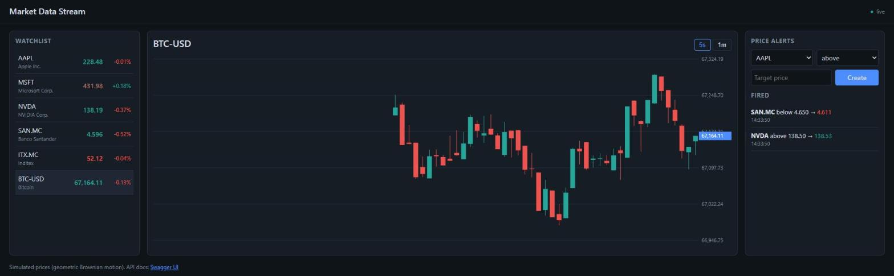
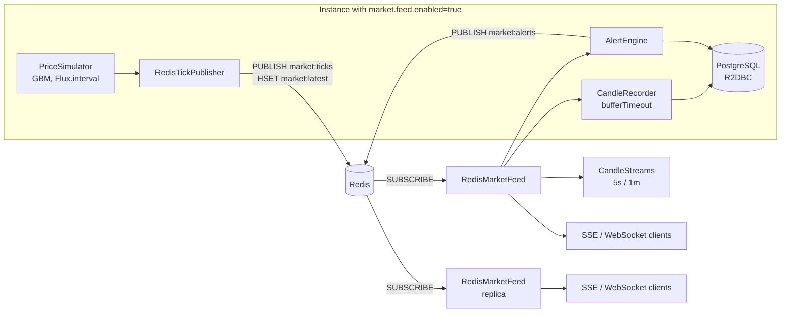

# Market Data Stream

[](https://github.com/Adri23Ausin/market-data-stream/actions/workflows/ci.yml)


A fully reactive, real-time market data service built with **Spring WebFlux and Project Reactor**. It simulates stock and crypto prices, streams them to browsers over **Server-Sent Events** and **WebSocket**, builds **OHLC candles** on the fly, stores them in PostgreSQL through **R2DBC**, fires **price alerts**, and scales horizontally by fanning ticks out through **Redis pub/sub**. A live dashboard is included.



### Author: Adrián Ausín Cuesta

## Contents

1. [Features](#features)
2. [Tech stack](#tech-stack)
3. [Architecture](#architecture)
4. [Run it](#run-it)
5. [API](#api)
6. [Tests](#tests)
7. [Design decisions](#design-decisions)
8. [Possible improvements](#possible-improvements)

## Features

- **Price simulation** with geometric Brownian motion (the model behind Black-Scholes), configurable drift and volatility per instrument, reproducible with a seed.
- **Live streams**: ticks and candles over SSE (with an initial snapshot, per-symbol throttling and heartbeats), and a WebSocket whose subscriptions can change on the fly.
- **OHLC candles** (5s and 1m) aggregated on event time, shared by all clients and stored in PostgreSQL in batches.
- **Price alerts** ("NVDA above 150") checked on every tick, fired exactly once and pushed to clients as they happen.
- **Horizontal scaling**: one instance generates prices, every instance streams them from Redis; new instances start with the latest prices already loaded.
- **Backpressure that fits market data**: a slow client loses old ticks, never slows the feed or the other clients down.
- **Live dashboard** (`/`) in plain HTML and JavaScript with a canvas candlestick chart.

## Tech stack

| Area | Technology |
|---|---|
| Language | Java 21 (records, sealed interfaces, pattern matching for `switch`) |
| Framework | Spring Boot 4.1, Spring WebFlux, Project Reactor, Reactor Netty |
| Streaming | Server-Sent Events, WebSocket, Reactor `Sinks` |
| Data | PostgreSQL 17 with R2DBC (non-blocking), Flyway, Redis 7 (pub/sub and hash) with reactive Lettuce |
| API docs | springdoc-openapi 3 (WebFlux) |
| Tests | JUnit 5, AssertJ, `StepVerifier` and virtual time, `WebTestClient`, Testcontainers (PostgreSQL, Redis) |
| Build & delivery | Maven wrapper, multi-stage Docker image, Docker Compose, GitHub Actions |

## Architecture



With `market.distribution=local` (the default) the same components run in a single process: the simulator feeds an in-memory sink instead of Redis.

The reactive pipeline in a few operators:

| Need | Operator |
|---|---|
| A tick per instrument every 250 ms | `Flux.interval` + `concatMapIterable`, on a `Scheduler` that tests replace with virtual time |
| One feed for every consumer, unaffected by slow ones | `Sinks.many().multicast().directBestEffort()` + a small `onBackpressureBuffer(DROP_OLDEST)` per subscriber |
| OHLC candles per symbol | `groupBy(symbol)` → `windowUntilChanged(bucket)` → `reduce(Candle::merge)` |
| At most one tick per symbol per N ms | `groupBy(symbol)` → `sample(period)` |
| WebSocket subscriptions that change on the fly | `receive()` → `scan(set)` → `switchMap(feed.filter(...))` |
| Batched database writes | `bufferTimeout(100, 2s)` → `concatMap(saveAll)` |

```
src/main/java/com/adrianausin/marketdata
├── feed/           # Tick, GBM simulator, MarketFeed, latest prices
├── candles/        # Candle, event-time aggregation, shared candle streams
├── distribution/   # Redis publisher, Redis-backed feed and price snapshot
├── history/        # R2DBC candle repository and recorder
├── alerts/         # Alerts, engine, in-process and Redis event channels
└── api/            # SSE, WebSocket and REST endpoints
```

## Run it

Requires **Docker**. To run outside Docker you also need **JDK 21**.

### Everything in Docker: two instances behind one Redis

```bash
docker compose --profile app up --build
```

| Service | URL |
|---|---|
| Primary (generates prices) | http://localhost:8080 |
| Replica (streams from Redis) | http://localhost:8081 |
| Swagger UI | http://localhost:8080/swagger-ui.html |

Open both dashboards side by side: they show the same prices tick by tick. Host ports can be changed with `APP_PORT`, `REPLICA_PORT`, `POSTGRES_PORT` and `REDIS_PORT`.

### Single instance on your machine

```bash
docker compose up -d postgres         # Redis is only needed in distributed mode
./mvnw spring-boot:run                # macOS / Linux
.\mvnw.cmd spring-boot:run            # Windows
```

The dashboard is at http://localhost:8080 (set `PORT` to use another port).

## API

[`requests.http`](requests.http) has ready-to-run examples.

| Method | Path | Description |
|---|---|---|
| `GET` | `/api/v1/instruments` | Instruments with their latest price |
| `GET` | `/api/v1/instruments/{symbol}/price` | Latest tick of one instrument |
| `GET` | `/api/v1/stream/ticks?symbols=AAPL,NVDA&throttleMs=500` | SSE: snapshot of latest prices, then live ticks |
| `GET` | `/api/v1/stream/candles?interval=5s&symbols=BTC-USD` | SSE: candles as they close (`5s` or `1m`) |
| `GET` | `/api/v1/candles/{symbol}?interval=1m&from=...&to=...&limit=120` | Stored candles, oldest first |
| `POST` | `/api/v1/alerts` | Create an alert `{"symbol": "NVDA", "direction": "ABOVE", "price": 150}` |
| `GET` | `/api/v1/alerts?status=ACTIVE` | List alerts |
| `DELETE` | `/api/v1/alerts/{id}` | Delete an alert |
| `GET` | `/api/v1/alerts/stream` | SSE: alerts as they fire |
| `WS` | `/ws/ticks` | Send `{"action": "subscribe", "symbols": ["AAPL"]}` or `"unsubscribe"`; receive ticks as JSON |

```
$ curl -N "localhost:8080/api/v1/stream/ticks?symbols=NVDA"
:connected

event:tick
data:{"symbol":"NVDA","price":138.70,"volume":86,"timestamp":"2026-10-29T13:33:01.218Z"}

event:tick
data:{"symbol":"NVDA","price":138.73,"volume":412,"timestamp":"2026-10-29T13:33:01.468Z"}
```

## Tests

```bash
./mvnw verify    # needs Docker running for Testcontainers
```

| Kind | What they cover |
|---|---|
| Simulator | GBM statistics (mean and volatility of log returns), timestamps and determinism with **virtual time** |
| Feed | Hot and shared, slow subscribers don't block others, one-at-a-time subscribers still see every instrument |
| Candles | OHLC values, symbols kept apart, emission on the next interval, event time vs arrival time |
| Streaming (`WebTestClient`) | SSE filtering and per-symbol throttling, candle stream, WebSocket subscriptions |
| Redis (Testcontainers) | A replica streams ticks published by another instance; the publisher round trip and latest-price hash |
| History (Testcontainers) | R2DBC batch insert, replays ignored, latest-N queries, live candles recorded |
| Alerts (Testcontainers) | Fire once and stream to clients, stay active when not reached, deletion, validation |

## Design decisions

- **Reactive all the way down.** Thousands of mostly idle streaming connections are the textbook case for an event loop: no thread per client. That only works if nothing blocks, which is why the database is reached through R2DBC and Redis through reactive Lettuce.
- **Market data is lossy on purpose.** The feed is a best-effort multicast sink: a client that can't keep up drops the *oldest* ticks from a small buffer, while the generator and the other clients carry on. The buffer exists because all instruments tick at the same instant, and a subscriber that requests one element at a time (like `concatMap`) would otherwise lose the rest of every burst. This was caught by a test.
- **Candles on event time.** A tick belongs to the candle of its own timestamp. A candle closes as soon as the first tick of the next interval arrives, so processing delays never move trades into the wrong candle. The first candle after a start is partial.
- **One writer, many readers.** Only the instance that generates prices records candles and evaluates alerts. Replicas just stream, so scaling out adds no duplicate writes.
- **Alerts fire exactly once.** Active alerts are indexed in memory (a map lookup per tick, not a query), and firing is a conditional `UPDATE ... WHERE status = 'ACTIVE' RETURNING`. Only one tick can win, even under concurrency.
- **SSE over WebSocket for one-way data.** SSE is plain HTTP, reconnects automatically in browsers and works through proxies. The WebSocket is there for clients that change their subscriptions without reconnecting. Every SSE stream starts with a comment, so headers are sent immediately, and sends a heartbeat every 15 seconds.
- **Testable time.** The simulator takes its `Scheduler` as a dependency, so tests compress minutes of simulated trading into milliseconds with `VirtualTimeScheduler`.

## Possible improvements

- Plug in a real market data provider (e.g. a WebSocket feed) behind the `MarketFeed` interface.
- Replace Redis pub/sub with Redis Streams or Kafka to replay missed ticks after a reconnection.
- Aggregate longer candles (5m, 1h) from stored 1m candles.
- Per-user alerts with authentication.
- Micrometer metrics for connected clients, tick rate and dropped ticks.

## License

[MIT](LICENSE)
